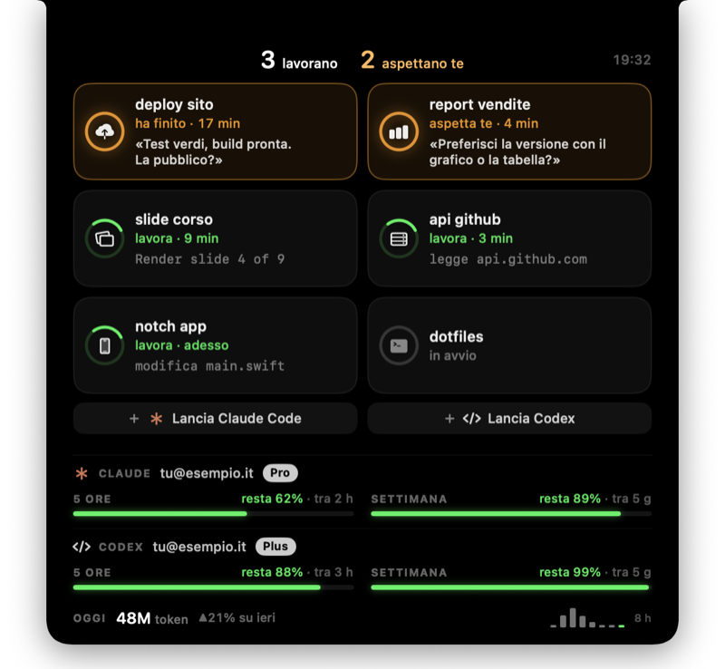

<div align="center">

# Notch Agenti

**Il notch del MacBook diventa il pannello di controllo delle tue sessioni di Claude Code.**<br>
Chi lavora, chi aspetta te, cosa ti sta chiedendo. Senza cercare il terminale giusto.

[](#cosa-serve)
[](Package.swift)
[](https://docs.claude.com/en/docs/claude-code)
[](LICENSE)

<br>


<sub>Una sessione ti fa una domanda → il notch si affaccia da solo → ci passi sopra col mouse e si apre.</sub>

<br><br>

[**Installa**](#installazione) &nbsp;·&nbsp; [Cosa fa](#cosa-fa) &nbsp;·&nbsp; [Cosa tocca sul tuo Mac](#cosa-tocca-sul-tuo-mac) &nbsp;·&nbsp; [Come funziona](#come-funziona)

</div>

<br>

## Cosa fa

<table>
<tr>
<td width="50%" valign="top">

<br><br>
<b>Da chiuso, si legge in mezzo secondo</b><br>
A sinistra quante sessioni lavorano, a destra quante <b>aspettano te</b>.
</td>
<td width="50%" valign="top">

<br><br>
<b>Quando una sessione si ferma, te lo dice lui</b><br>
Il notch si affaccia per qualche secondo con la domanda, e un suono.
</td>
</tr>
</table>

<p align="center">

</p>

<table>
<tr><td width="50%" valign="top">🧩 <b>Un riquadro per sessione</b><br>Cosa sta facendo («modifica main.swift») o cosa ti chiede, e da quanto. Chi aspetta te sta in cima.</td><td width="50%" valign="top">👆 <b>Un clic e sei lì</b><br>Porta in primo piano il terminale di quella sessione; su Terminal e iTerm2 anche la scheda esatta.</td></tr>
<tr><td width="50%" valign="top">✨ <b>Nuove sessioni dal notch</b><br>«Lancia Claude Code» o «Lancia Codex»: scrivi cosa deve fare e si apre nel terminale.</td><td width="50%" valign="top">📊 <b>I limiti sotto gli occhi</b><br>Quanto resta delle 5 ore e della settimana, per Claude e per Codex, e i token di oggi contro ieri.</td></tr>
<tr><td width="50%" valign="top">🔔 <b>Suoni discreti</b><br>Una domanda si sente più di un turno finito. Due kit, o spenti.</td><td width="50%" valign="top">💻 <b>Anche senza notch</b><br>Sui Mac senza notch diventa una piccola pillola sotto il bordo dello schermo.</td></tr>
</table>

## Installazione

```bash
git clone https://github.com/mattiacalastri/notch-agents.git
cd notch-agents
bash scripts/install.sh
```

Lo script compila l'app, la mette in `~/Applications`, la avvia al login e la collega a Claude Code. Poi porta il mouse sul notch.

> [!NOTE]
> Le sessioni di Claude Code già aperte compaiono quando le riavvii; le nuove subito.
> La prima volta che clicchi su un riquadro, macOS chiede il permesso di controllare Terminal o iTerm2: serve a selezionare la scheda giusta. Se lo neghi, l'app porta comunque in primo piano la finestra.

| Per | Comando |
|---|---|
| Aggiornare | `git pull && bash scripts/install.sh` |
| Togliere | `bash scripts/uninstall.sh` — rimette Claude Code com'era |

### Cosa serve

- **macOS 14** Sonoma o successivo
- **[Claude Code](https://docs.claude.com/en/docs/claude-code)** installato e con accesso fatto
- **Strumenti di Apple** per compilare: `xcode-select --install`
- **Codex CLI**, facoltativo, con accesso tramite ChatGPT

I limiti di 5 ore e della settimana compaiono con un abbonamento Pro o Max: con una chiave API, Claude Code non li comunica.

## Cosa tocca sul tuo Mac

| Dove | Cosa |
|---|---|
| `~/.claude/settings.json` | Aggiunge un hook ai momenti della sessione (inizio, messaggio, strumento, notifica, fine) e la sua status line. Prima ne salva una copia accanto (`settings.json.bak-notch-agenti-…`). Se avevi già una status line, continua a disegnare la tua. |
| `~/.notch-agenti/` | I due script collegati a Claude Code e lo stato delle sessioni (una parola per terminale). |
| `~/Applications/Notch Agenti.app` | L'app. |
| `~/Library/LaunchAgents/com.mattiacalastri.notch-agenti.plist` | L'avvio al login. |

> [!TIP]
> **Tutto resta sul tuo Mac.** L'unica chiamata in rete è per i limiti di Codex: l'app chiede a `chatgpt.com` gli stessi numeri che chiede Codex CLI, con la sessione che Codex tiene in `~/.codex/auth.json` (la legge, non la scrive e non la mostra). È un indirizzo non documentato da OpenAI: se cambia, la riga di Codex resta all'ultimo valore letto.

## Uso

- **Clic destro → Suoni**: «Sine» (predefinito), «Sistema» (i suoni del Mac) o spenti. Si può spegnere solo il suono di apertura e chiusura; «Prova i suoni» li fa sentire tutti.
- **Clic destro → Esci** chiude l'app fino al prossimo login, o finché non la riapri da `~/Applications`.
- Il nome di un riquadro è la cartella in cui hai aperto la sessione; l'icona si sceglie dalle parole del nome (`deploy`, `report`, `sito`, `api`…).

## Come funziona

```
Claude Code ── hook ─────────▶  ~/.notch-agenti/run/state_<tty>.txt
            ── hook ─────────▶  ~/.notch-agenti/run/transcript_<tty>.txt
            ── status line ──▶  ~/.notch-agenti/run/statusline.json
                                          │
Notch Agenti ◀── ogni secondo: ps (terminali con un claude vivo) + quei file
             ◀── le trascrizioni in ~/.claude/projects (domande, token)
```

Una sessione conta solo finché sul suo terminale c'è un processo `claude` vivo. Il codice è in due parti: `Sources/NotchAgentiCore`, la logica, tutta coperta da test, e `Sources/NotchAgenti/main.swift`, il pannello sul notch in AppKit + SwiftUI.

<details>
<summary><b>Sviluppo</b></summary>

<br>

```bash
swift test                              # la logica
bash Tests/hooks_test.sh                # l'hook e la status line
python3 Tests/claude_settings_test.py   # le modifiche a settings.json
bash Tests/install_test.sh              # installa e disinstalla in una cartella usa e getta
```

| Variabile | Effetto |
|---|---|
| `NOTCH_AGENTI_FIXTURE=1` | Dati finti, per le schermate |
| `NOTCH_AGENTI_OPEN=1` | Tiene il notch aperto |
| `NOTCH_AGENTI_DEMO=1` | Lo apre e chiude ogni 1,5 secondi |
| `NOTCH_AGENTI_DEMO=tour` | Ripete il giro dell'animazione in cima a questa pagina (con `FIXTURE=1`) |

`python3 scripts/sounds_make.py` rigenera i suoni «Sine»: sono sintetizzati, nessun campione di terzi.

</details>

<br>

<div align="center">
<sub><a href="LICENSE">Licenza MIT</a> · © Mattia Calastri</sub>
</div>
